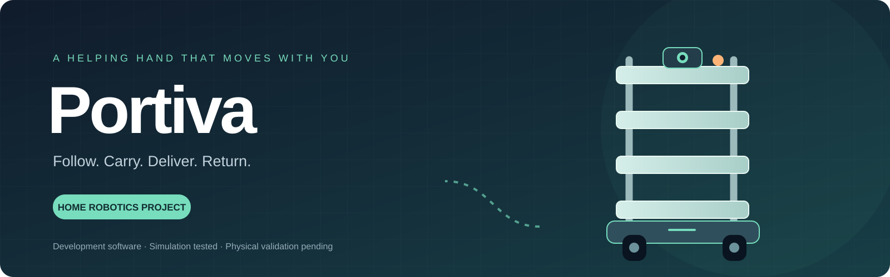
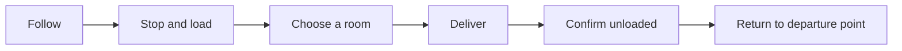
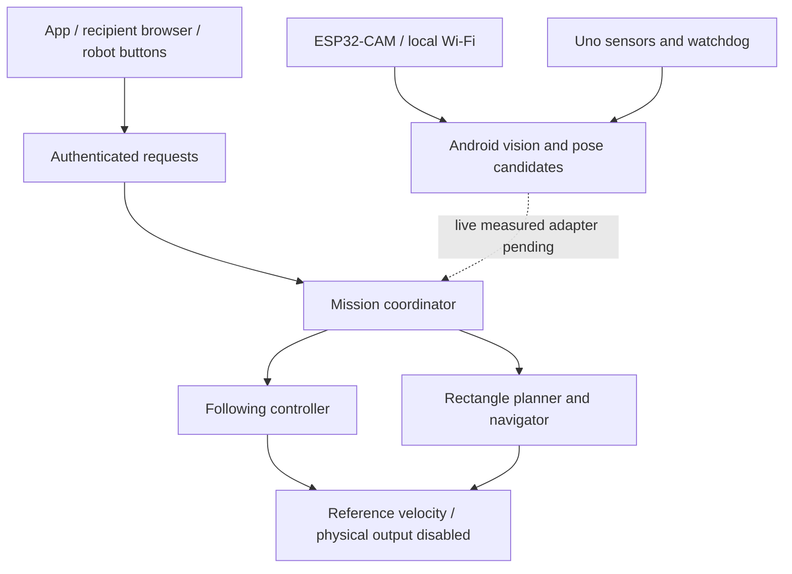

<div align="center">



**A home robot designed to follow a person, carry everyday items, and deliver them across rooms.**

[](https://github.com/adilsukumar/Portiva/actions/workflows/software-checks.yml)


[Start building](docs/START-BUILDING.md) · [Architecture](docs/ARCHITECTURE.md) · [Software guide](docs/SOFTWARE.md) · [Tests](docs/TESTING.md)

</div>

## Built for the trips that add up

Repeated carrying trips around a home can take time and effort. Portiva explores how a small mobile trolley could keep everyday items within reach and deliver them between registered rooms.

The goal is a tall, accessible carrying companion. It should stay nearby while she walks, stop for loading, take items to a selected room and return after unloading. The design is growing into a household delivery robot, with no floor tape or installed navigation markers.

> **Current release:** executable development software with an Android demo, shared mission controllers, camera tools and board firmware. Simulated workflows pass. Real autonomous use, the 5 kg assembly and the complete ₹3,000 budget are **not yet validated**. Motor outputs remain locked at zero.

## The everyday flow



| Capability | Implemented software | Still needed for physical use |
|---|---|---|
| Follow a selected person | YOLO detector, appearance association, following controller and fault holds | Selected-person identity, measured distance and phone-speed validation |
| Deliver and return | Shared request coordinator, recorded origin, arrival/unload states | Surveyed home data and measured live observations |
| Plan around walls | Heading-aware rectangle A* and swept-body collision checks | Live obstacle integration and measured position/heading uncertainty |
| Request from another phone | Local browser page, token authentication and bounded request queue | Household Wi-Fi and background-service trials |
| Use physical buttons | FOLLOW/SEND telemetry events enter the inbox | Actual wiring and switch trials |
| Control the base | Uno protocol, watchdog and sensor firmware | Selected drive hardware, stop wiring and commissioning |

## Try it without buying anything

Python 3.11+, JDK 17+ and a C++17 compiler are required for the portable core tests. They need no Android SDK, model download, phone or robot.

```bash
git clone https://github.com/adilsukumar/Portiva.git
cd Portiva
python -m pip install -r implementation/requirements-core.txt
python implementation/check_core.py
```

The Android offline demo uses the **same rectangle planner and mission coordinator** as the host simulation. It offers follow, load, delivery, explicit return and fault controls. Its room and observations are artificial. It is not a digital twin of the home.

```bash
python portiva.py demo       # Run the shared Java mission simulation
python portiva.py plan       # Plan in the synthetic example map
python portiva.py doctor     # Check local development dependencies
```

`doctor` may report missing Android/model tools on a fresh clone. The core tests do not need those tools. Python and a PC are for development; the intended deployed processor is the owned Redmi.

## The software stack



The planned stack reuses an Arduino Uno, MPU6050 and Android phone. HC-05, relays and a GNSS module are available, but they are not substitutes for indoor position sensing. Phone radio strength does not identify a room or measure a reliable following distance.

## Build the Android bench app

Install Android SDK platform 35 and build-tools 35.0.0. Set `ANDROID_SDK_ROOT` and `JAVA_HOME` if they are not discoverable. Fetch the pinned upstream dependencies and export the model in a development environment:

```bash
python -m pip install -r implementation/requirements-model-export.txt
python implementation/fetch_dependencies.py --export-model
python implementation/test_detector.py
python portiva.py build
```

This creates `implementation/Portiva-Bench.apk`. The APK supports Android 8/API 26+ and includes ARM64, ARM32 and x86-64 native libraries. Large model/runtime binaries and APKs are intentionally excluded from Git. The internal Android package remains `in.rollingtable.prototype` for compatibility.

Read the [software guide](docs/SOFTWARE.md) and [board setup](docs/SOFTWARE.md) before using the camera bench. Generate private credentials locally; never publish populated `secrets.h` or signing keys. Third-party model and runtime terms are listed in [THIRD_PARTY_NOTICES.md](THIRD_PARTY_NOTICES.md).

## What the tests establish

| Evidence | Result | Scope |
|---|---:|---|
| Shared mission demo | 4,974 assertions passed | Virtual round trip, following and fault holds; many assertions check each simulation step |
| Java rectangle planner | 168 checks passed | Path geometry, bad inputs and search bounds |
| Independent native OpenCV geometry | 1,000 random poses + 1,558 route samples passed | Artificial doorway, not the home |
| Request coordinator | 15 checks passed | Expiry, duplicate requests, rest requirements and fault behaviour |
| Recipient HTTP/inbox | 50 checks passed | Actual localhost HTTP; no household phones |
| C++ control and sensors | 4,029 + 30 + 69 checks passed | Protocol, watchdog, sonar timing and telemetry; no boards |

These counts are **not success percentages or thousands of delivery trips**. The detector and procedural localizer have also run on an Android emulator. Emulator performance does not establish Redmi performance. See [testing notes](docs/TESTING.md) for current native results and limitations.

## Ready to start the hardware?

**Yes: the camera development stage is a concrete first step.** The listed camera and programmer subtotal is **₹1,011**, before shipping, cable and any additional power supply. [See the two-item kit, seller links and exact bench steps](docs/START-BUILDING.md).

The entire moving trolley is not yet a checkout-ready ₹3,000 build. The aim is a 5 kg payload, tall accessible shelves and four wheels within an 18-inch envelope. Rack/base fit, load distribution, motor capacity, battery/charger and real stopping tests still need work. Buying this first camera kit is research spending, not a guarantee that all remaining parts will fit the budget.

## Project layout

```text
portiva.py                  One Python entry point
implementation/
  android/src/              Android UI, vision and shared Java controllers
  firmware/base/            Arduino Uno sensor/control bench
  firmware/camera/          ESP32-CAM health, images, telemetry and STOP
  config/                   Synthetic map and empty survey templates
  tests/                    Java and C++ executable checks
  check_core.py             Portable test command used in CI
  fetch_dependencies.py     Explicit checksum-verified dependency downloads
docs/                       Architecture, testing and first purchase guide
```

The internal package retains an earlier working name; the product is **Portiva**. Historical experiments, house pictures, caches, downloaded toolchains, generated APKs and private configuration are excluded from this repository. Family-specific documents and household data stay in the private development workspace.
