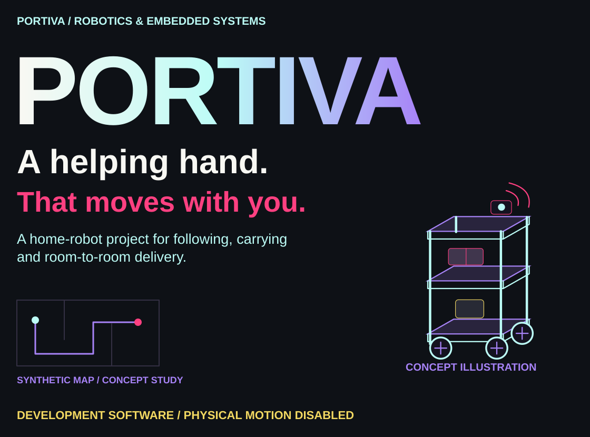
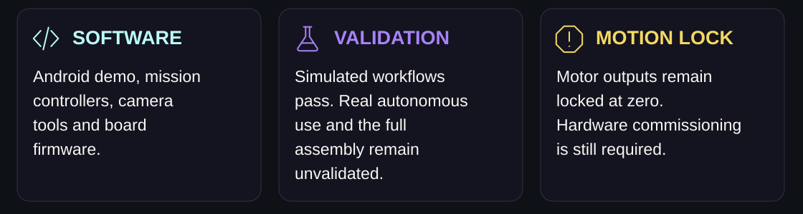
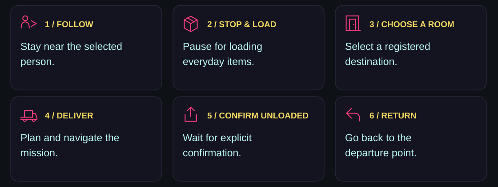
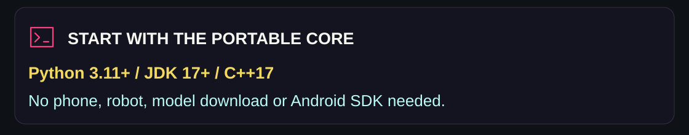
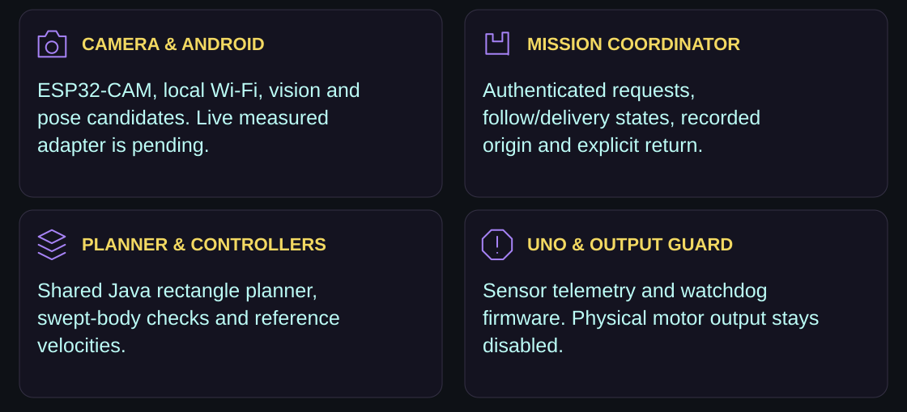
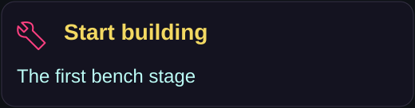
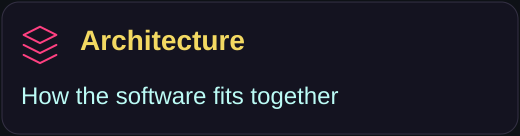
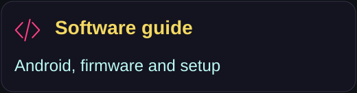
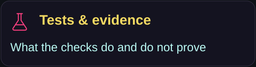
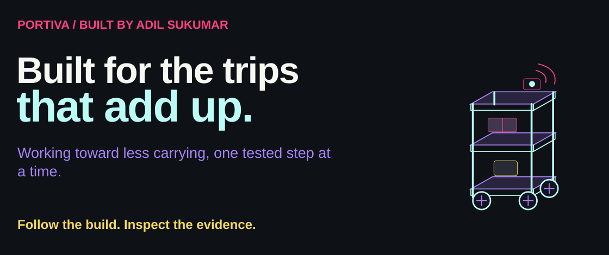

<p><picture><source media="(max-width: 600px)" srcset="docs/assets/readme/hero-mobile.svg"/></picture></p>


<p align="center"><a href="#the-everyday-flow">Mission</a> · <a href="#try-it-without-buying-anything">Try the core</a> · <a href="#the-software-stack">Software</a> · <a href="#what-the-tests-establish">Evidence</a> · <a href="#build-guides">Build guides</a></p>


**A home robot designed to follow a person, carry everyday items, and deliver them across rooms.**


##  Built for the trips that add up


Repeated carrying trips around a home can take time and effort. Portiva explores how a small mobile trolley could keep everyday items within reach and deliver them between registered rooms.


The goal is a tall, accessible carrying companion. It should stay nearby while she walks, stop for loading, take items to a selected room and return after unloading. The design is growing into a household delivery robot, with no floor tape or installed navigation markers.


<p><picture><source media="(max-width: 600px)" srcset="docs/assets/readme/status-mobile.svg"/></picture></p>


##  The everyday flow


<p><picture><source media="(max-width: 600px)" srcset="docs/assets/readme/mission-mobile.svg"/></picture></p>


<details>

<summary><strong>Capability-by-capability implementation and physical-validation requirements</strong></summary>


| Capability | Implemented software | Still needed for physical use |

|---|---|---|

| Follow a selected person | YOLO detector, appearance association, following controller and fault holds | Selected-person identity, measured distance and phone-speed validation |

| Deliver and return | Shared request coordinator, recorded origin, arrival/unload states | Surveyed home data and measured live observations |

| Plan around walls | Heading-aware rectangle A* and swept-body collision checks | Live obstacle integration and measured position/heading uncertainty |

| Request from another phone | Local browser page, token authentication and bounded request queue | Household Wi-Fi and background-service trials |

| Use physical buttons | FOLLOW/SEND telemetry events enter the inbox | Actual wiring and switch trials |

| Control the base | Uno protocol, watchdog and sensor firmware | Selected drive hardware, stop wiring and commissioning |


</details>


##  Try it without buying anything


<p><picture><source media="(max-width: 600px)" srcset="docs/assets/readme/environment-mobile.svg"/></picture></p>


Python 3.11+, JDK 17+ and a C++17 compiler are required for the portable core tests. They need no Android SDK, model download, phone or robot.


```bash

git clone https://github.com/adilsukumar/Portiva.git

cd Portiva

python -m pip install -r implementation/requirements-core.txt

python implementation/check_core.py

```


The Android offline demo uses the **same rectangle planner and mission coordinator** as the host simulation. It offers follow, load, delivery, explicit return and fault controls. Its room and observations are artificial. It is not a digital twin of the home.


```bash

python portiva.py demo       # Run the shared Java mission simulation

python portiva.py plan       # Plan in the synthetic example map

python portiva.py doctor     # Check local development dependencies

```


`doctor` may report missing Android/model tools on a fresh clone. The core tests do not need those tools. Python and a PC are for development; the intended deployed processor is the owned Redmi.


##  The software stack


<p><picture><source media="(max-width: 600px)" srcset="docs/assets/readme/architecture-mobile.svg"/></picture></p>


The current plan mounts the Android phone on the trolley and uses its own camera and processor. HC05 Bluetooth Classic serial is the planned link to the Uno; that adapter is unfinished. The separate ESP32 camera and programmer are no longer required. HC05 does not locate a person or room. The architecture illustration above predates this input change; the coordinator, planner and motion lock remain the same.


##  Build the Android bench app


Install Android SDK platform 35 and build-tools 35.0.0. Set `ANDROID_SDK_ROOT` and `JAVA_HOME` if they are not discoverable. Fetch the pinned upstream dependencies and export the model in a development environment:


```bash

python -m pip install -r implementation/requirements-model-export.txt

python implementation/fetch_dependencies.py --export-model

python implementation/test_detector.py

python portiva.py build

```


This creates `implementation/Portiva-Bench.apk`. The APK supports Android 8/API 26+ and includes ARM64, ARM32 and x86-64 native libraries. Large model/runtime binaries and APKs are intentionally excluded from Git. The internal Android package remains `in.rollingtable.prototype` for compatibility.


Read the [software guide](docs/SOFTWARE.md) before starting the phone camera bench. Frames stay in memory, and capture stops when the activity leaves the foreground. There is no robot connection. Never publish private credentials or signing keys. Third-party model and runtime terms are listed in [THIRD_PARTY_NOTICES.md](THIRD_PARTY_NOTICES.md).


##  What the tests establish


| Evidence | Result | Scope |

|---|---:|---|

| Shared mission demo | 4,974 assertions passed | Virtual round trip, following and fault holds; many assertions check each simulation step |

| Java rectangle planner | 168 checks passed | Path geometry, bad inputs and search bounds |

| Independent native OpenCV geometry | 1,000 random poses + 1,558 route samples passed | Artificial doorway, not the home |

| Request coordinator | 15 checks passed | Expiry, duplicate requests, rest requirements and fault behaviour |

| Recipient HTTP/inbox | 50 checks passed | Actual localhost HTTP; no household phones |

| C++ control and sensors | 4,029 + 30 + 69 checks passed | Protocol, watchdog, sonar timing and telemetry; no boards |


These counts are **not success percentages or thousands of delivery trips**. The detector and procedural localizer have also run on an Android emulator. Emulator performance does not establish Redmi performance. See [testing notes](docs/TESTING.md) for current native results and limitations.


##  Ready to start the hardware?


**Use the mounted phone camera first.** Portiva Bench now includes a local rear-camera detection screen. Synthetic Camera2 capture, detector use and activity restart passed on the tested APK. HC05 and physical mission integration remain unfinished. The separate camera kit is historical; do not buy it for this architecture. [See the current bench steps](docs/START-BUILDING.md).


The entire moving trolley is not yet a checkout-ready ₹3,000 build. The aim is a 5 kg payload, tall accessible shelves and four wheels within an 18-inch envelope. Rack/base fit, load distribution, motor capacity, battery/charger and real stopping tests still need work. Mounting an existing phone reduces hardware purchases, but it does not establish a complete cap-compliant assembly.


##  Build guides


<p align="center"><a href="docs/START-BUILDING.md"></a> <a href="docs/ARCHITECTURE.md"></a> <a href="docs/SOFTWARE.md"></a> <a href="docs/TESTING.md"></a></p>


<details>

<summary><strong>Project layout and repository hygiene</strong></summary>


```text

portiva.py                  One Python entry point

implementation/

  android/src/              Android UI, vision and shared Java controllers

  firmware/base/            Arduino Uno sensor/control bench

  firmware/camera/          ESP32-CAM health, images, telemetry and STOP

  config/                   Synthetic map and empty survey templates

  tests/                    Java and C++ executable checks

  check_core.py             Portable test command used in CI

  fetch_dependencies.py     Explicit checksum-verified dependency downloads

docs/                       Architecture, testing and first purchase guide

```


The internal package retains an earlier working name; the product is **Portiva**. Historical experiments, house pictures, caches, downloaded toolchains, generated APKs and private configuration are excluded from this repository. Family-specific documents and household data stay in the private development workspace.


</details>


<p><picture><source media="(max-width: 600px)" srcset="docs/assets/readme/closing-mobile.svg"/></picture></p>


<p align="center"><a href="https://github.com/adilsukumar/Portiva/issues">Discuss the build</a> · <a href="docs/TESTING.md">Inspect the evidence</a> · <a href="https://www.adilsukumar.xyz/">Meet the builder</a></p>

