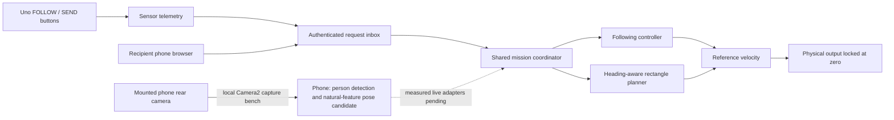

# How Portiva works

Portiva is a home carrying robot project. Its intended cycle is follow, stop for loading, deliver, wait for unloading, and return. The current release is a development bench. Physical motor outputs are disabled.

## Software that runs now

`MissionCoordinator` accepts typed requests. It checks request age, replay, stationary pose, mission state and supplied evidence. A delivery records the departure pose. RETURN requires an arrival state and an explicit unloading request. Missing evidence latches a hold. Clearing a fault does not resume travel.

`RectanglePlanner` plans forward translations and turns at eight headings. It checks a 390 mm forward by 410 mm lateral body, plus padding. Separating-axis collision checks include an additional displacement allowance between sweep samples. A summed-area grid makes empty regions cheap to check. Search expansion and time budgets prevent an unbounded search. This is a discrete reference route, not a guarantee of the shortest continuous route.

`RectangleNavigation` follows that route with supplied pose and speed. `MissionDemo` supplies artificial observations and assumed acceleration/braking. The Android offline demo and host tests execute these same classes.

`RecipientServer` hosts a small local browser page. Requests require a temporary token. STOP supersedes queued requests. The queue and HTTP connections are bounded. Delivery selects a registered room; it does not locate a phone from its Wi-Fi signal. The demo has an explicit control for applying a queued request to the virtual world. There is no automatic bridge to live wheel power.

`Detector` runs YOLO11n using ONNX Runtime. `TargetTracker` associates a selected appearance and holds on ambiguity or staleness. Appearance is not personal identity. `PlanarLocalizer` estimates candidate camera pose from measured natural wall features using OpenCV ORB/PnP. It is not automatic SLAM. The camera/base transform utility handles surveyed mounting geometry.

`PhoneCamera` captures one rear-camera JPEG at a time and waits for its listener before requesting another frame. `PhoneCameraActivity` runs local detection, reports timings and stops the session on pause. It has no motor or Bluetooth transport. Capture restart and resource closure need native tests and physical device checks.

Uno firmware reads sensor information and contains a packet watchdog. The planned HC05 Bluetooth Classic serial adapter is unfinished. ESP32-CAM firmware is retained as a legacy bench; it is not a purchase dependency of the phone-mounted architecture. No enabled physical driving system is provided.

## Work that needs hardware and measured data

The system still needs a reliable selected-person identity/range input, measured speed and braking, a surveyed house map, calibrated camera mounting, live uncertainty/obstacle integration and physical commissioning. A request cannot manufacture this evidence. The phone, camera and loaded drive have not been tested physically.

The existing Android package `in.rollingtable.prototype` and C++ namespace are retained for compatibility. The product name is Portiva. Python and a PC are development tools; the intended runtime uses the Redmi and onboard boards.
